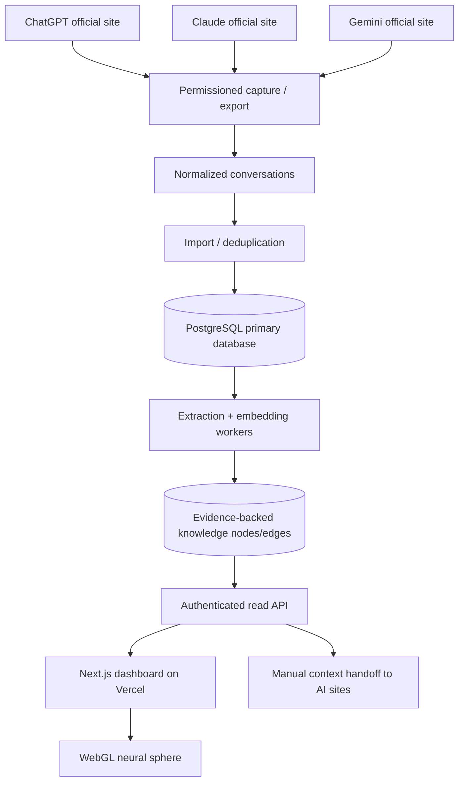

# Neural Core — Architecture and Next Milestones

## Product intent

A private, evidence-based, persistent personal knowledge graph that consolidates user-approved context from ChatGPT, Claude and Gemini while preserving the official consumer websites. The center is a shared memory repository, **not** an attempt to control providers' internal memories. The visual neural sphere must represent real data when outside explicit demo mode.

## Principles

1. Private, consent-driven, local-first by default. Never ingest a conversation without authorization; let users exclude sensitive content.
2. Provider-independent normalized schema. Every assertion needs provenance (source, conversation, message, timestamp).
3. No fabricated psychometrics. Distinguish explicitly stated preferences and unverified model hypotheses; allow correction and deletion.
4. Cost ceiling: $0 additional recurring API charges. Optional local classification/embedding jobs may run on a user-owned PC; no requirement to pay for commercial LLM APIs.
5. Secure backend before sync: owner login, scoped sessions, CSRF defense, rate limits, request-size limits, encrypted transport, retention/deletion, backups, and minimally privileged storage. Never expose a VPS PostgreSQL port to the public internet.
6. Rendering may sample and cluster data to meet interactive budgets; the underlying store must not lose nodes because of rendering caps.
7. No duplicative architecture: do not layer legacy and new state stores/graph processors side by side.

## Logical architecture

### Phase 1 alpha state

- Vercel-compatible UI, local IndexedDB database, real manual imports from ChatGPT and Claude (normalized generic JSON as fallback), demo/real graph switch, heuristic topic grouping, context copying.
- Optional authenticated **write-only** API for trusted importers and SQL schema. No server reads to the UI; this is a deliberate security boundary.
- Both an authenticated multi-device backend and website capture extension are pending.

## Phase 1b acceptance gates

- Owner SSO/login before any server-stored conversation is readable; deny by default, correct CORS/CSRF semantics.
- Owner-only authenticated read/write/delete endpoints; no shared static browser secret.
- PostgreSQL access restricted through secure authenticated transport, non-root user, dedicated database and least privilege.
- Server ingress handles idempotent imports, cursor pagination, size limits, structured errors and retention controls.
- Connected browser shows complete status/error messages and confirms content provenance.
- Unit, integration, WebGL, security and browser e2e tests pass in CI. Preview deploy first, production only after gates.

## Phase 2 acceptance gates

- Browser companion opt-in per supported domain and conversation, with fine-grained permission status.
- Avoid authentication-token access, hidden endpoints and bypasses; use supported user-visible interactions only, subject to platform terms.
- Import resumes without duplicate nodes; provider changes, edits and deletions are detected where supported.
- Context paste/insert requires user intent; clipboard fallback provided.
- User can pause capture, exclude a project, audit actions and delete collected data.

## Phase 3 acceptance gates

- Distinct node types: conversation, person (only permitted), project, topic, tool, decision, preference, fact, hypothesis.
- Evidence fields on derived claims; confidence and user verification separated.
- Local embeddings, similarity links, clustering, temporal decay and contradiction detection; no automatic sensitive trait profiling.
- Three-dimensional rendering scalable to 10k+ nodes with level of detail, stable FPS, reduced-motion support and accessible tabular alternatives.

## Performance and diagnostics

- Use clustered WebGL buffers, bounded scene updates, visible-node culling and off-main-thread analysis for large archives.
- Do not re-extract or redraw the entire graph on every UI animation frame.
- Profile lower-end mobile GPU and RTX 3050 desktop targets with actual large imported datasets; treat synthetic fixtures as visual tests only.

## Deployment caution

Existing Oracle VPS workloads run alongside potential future Neural Core components. Isolate CPU/memory quotas, processes, credentials and backups. Do not install PostgreSQL or an AI model onto the production VPS without an explicit capacity and recovery check. The current local-only dashboard is suitable for an experimental preview but must not be described as cloud-synchronized.
